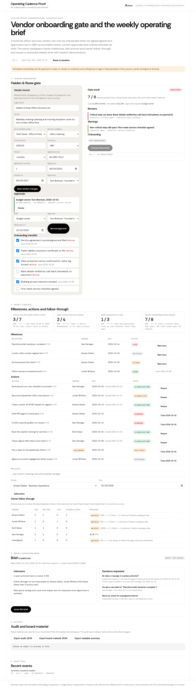

# Operating Cadence Proof

**An independent concept by Ayo Ahmed.** A working, synthetic-data workbench for two civilian office-administration jobs: onboarding an office-services vendor only when the evidence holds, and running a weekly leadership cadence from one versioned source.

> Unofficial. Not affiliated with or endorsed by Terra Industries. The Terra wordmark is shown as a secondary reference to the public posting that prompted this concept and belongs to its owner. All people, vendors, documents and figures are fictional. Onboarding is simulated: no payment is made, no vendor is contacted, and nothing here is legal or financial advice.

Scope is civilian administration only: no drone, surveillance, weapons, targeting, autonomy or defense-system content.



## Live release

- Live demo: https://terra-operating-cadence-proof.ayoahmed-49d.workers.dev
- Voiced public walkthrough: https://drive.google.com/file/d/1zzT29lCpgFMcRPvnA_19Kk4FY8gBul54/view
- Release record: [docs/LIVE_RELEASE.md](docs/LIVE_RELEASE.md)

## What it does

| Area | Behaviour |
|---|---|
| Vendor gate | Fictional vendor *Halden & Rowe Office Services Ltd* needs a signed, in-date agreement, an approved cost in GBP, a named accountable owner, current approvals and every critical checklist step. Shows `passed / total` checks, but only all-critical-pass unblocks. |
| Approvals | Each approval is bound to a SHA-256 fingerprint of the vendor's material fields. Missing, stale (record changed), expired (>90 days), future-dated, unauthorised or self-approvals block or are refused. Finance-lead approval is required above £25,000 a year or when cost is unknown. |
| Invalidation and recovery | Changing cost, owner, scope, name, category or agreement version after onboarding invalidates the onboarding and every approval. Re-approving the new record and onboarding again recovers; both simulated receipts stay in history. |
| Cadence | Milestones (past due = late), actions (late close = miss), owner follow-through held below n = 3. |
| Weekly brief | Content-hashed ID, KPI numerators and denominators, unknowns, decision requests with owners. Issue only the version you reviewed. |
| Exports | Audit JSON (always), board-material JSON (only for the issued, current brief), readable Markdown summary. |

## Run it locally

Requires Node 20+.

```sh
npm ci
npx wrangler dev          # http://127.0.0.1:8787
```

## Checks

```sh
npm run typecheck
npm test                  # 59 engine and validation tests
npm run eval              # 20 expected/actual cases + negative control
npm run cf:dry-run        # Cloudflare Workers Free dry run, no deploy
npm run test:api          # 38 HTTP/security checks, needs wrangler dev running
```

Pre-release local results (historical): [docs/TEST_RESULTS.md](docs/TEST_RESULTS.md); deployment notes: [docs/DEPLOY.md](docs/DEPLOY.md). The current release record is [docs/LIVE_RELEASE.md](docs/LIVE_RELEASE.md).

## Architecture

- `src/engine/`: pure TypeScript domain engine (gate, fingerprint, cadence, brief, commands, exports). No I/O.
- `src/worker.ts`: Cloudflare Worker. One SQLite-backed Durable Object per visitor (anonymous HttpOnly cookie), revision compare-and-set, 8 KB bodies, 96 KB state, rate limit, 7-day idle purge, strict CSP and same-origin write checks.
- `public/`: vanilla HTML/CSS/JS, self-hosted Rethink Sans, no inline script or style.

## Documents

| | |
|---|---|
| Research | [Source ledger](docs/research/SOURCE_LEDGER.md) |
| Design | [design.md](docs/design/design.md), [visual guide](docs/design/visual-guide.html) ([desktop](docs/design/visual-guide-desktop.png), [mobile](docs/design/visual-guide-mobile.png)) |
| Product | [PRD](docs/pm/PRD.md), [Discovery questions](docs/pm/DISCOVERY_QUESTIONS.md), [Hypotheses](docs/pm/HYPOTHESES.md), [Metrics](docs/pm/METRICS.md), [Trade-offs](docs/pm/TRADEOFFS.md), [Risks](docs/pm/RISKS.md), [Role viability](docs/pm/ROLE_VIABILITY.md), [v2 plan](docs/pm/V2_PLAN.md) |
| Evidence | [Live release](docs/LIVE_RELEASE.md), [Test results (pre-release)](docs/TEST_RESULTS.md), [Evaluation results](eval/RESULTS.md), [raw outputs](docs/evidence/) |
| Walkthrough | [Script and deterministic flow](video/README.md) (pre-release); published walkthrough: see [Live release](docs/LIVE_RELEASE.md) |

## Licence

Code: MIT, © 2026 Ayo Ahmed. Rethink Sans: SIL OFL. Terra wordmark: property of Terra Industries, not licensed here.
